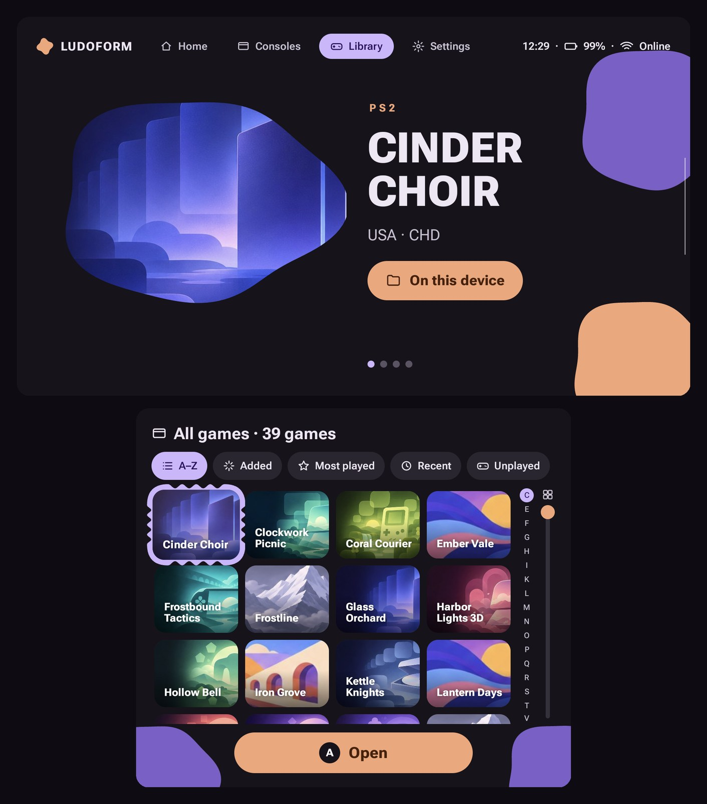
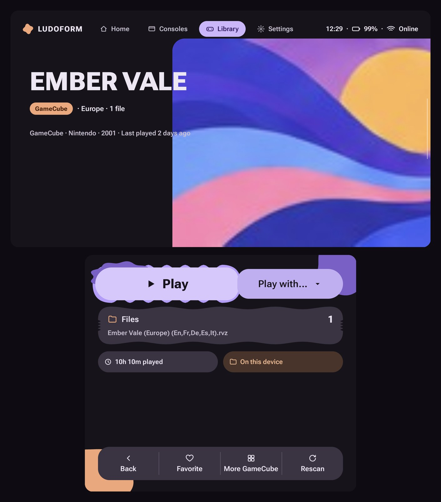
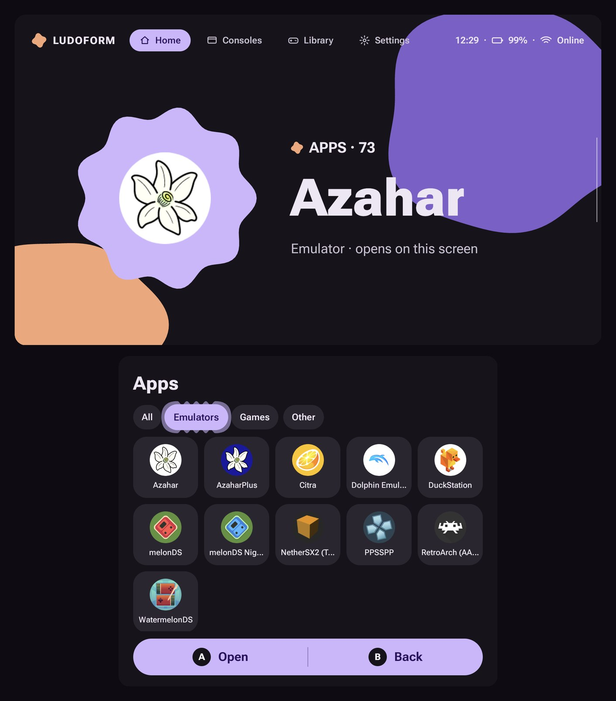
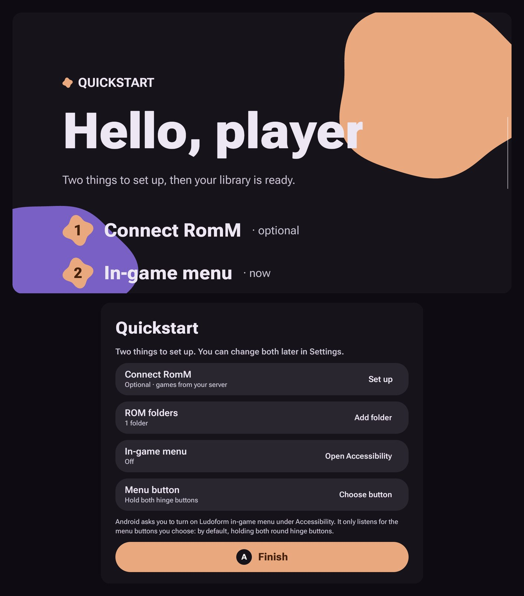

# Ludoform

A dual-screen Android launcher for the AYN Thor (top 1920×1080, bottom 1240×1080), with RomM library sync.

Work happens through GitHub issues and pull requests into `main`. Start with `docs/BUILD-PROMPT.md`, `docs/STATUS.md` and `docs/LOG.md` once they land.

## Screenshots

From the showcase build on an AYN Thor: top screen above, bottom screen below. The games are invented placeholders whose file names follow No-Intro and Redump naming; no ROMs are included.

| | |
|---|---|
|  |  |
| Home | Library |
|  |  |
| Game details | Consoles |
|  |  |
| App drawer, Emulators | Quickstart |
|  | |
| Settings | |

To try the design without a library, install `ludoform-showcase` from the latest [Android CI](https://github.com/lunikodevelopment/ludoformlauncher/actions/workflows/ci.yml) run, or build it with `./gradlew assembleShowcase`. It installs next to Ludoform as "Ludoform Showcase". Placeholder games say so instead of starting.

## Start here

- `docs/HANDOFF-CHATGPT.md`: handoff for whoever continues (written for ChatGPT, works for anyone)
- `docs/HANDOFF-CLAUDE.md`: the newest handoff (for a new Claude account); read this one first
- `docs/BUILD-PROMPT.md`: the full build specification and workflow
- `docs/STATUS.md` and `docs/LOG.md`: where the work stands and the next step
- `docs/design/boards/`: the 22 design boards at the Thor's real proportions
