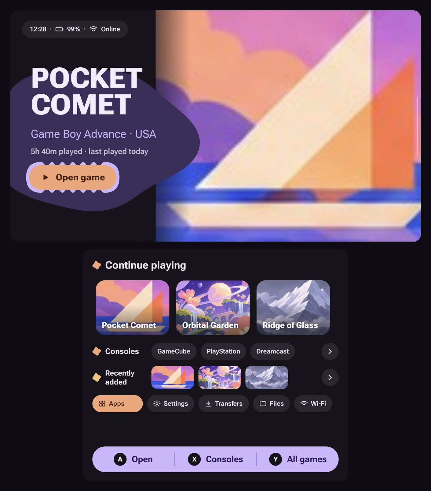
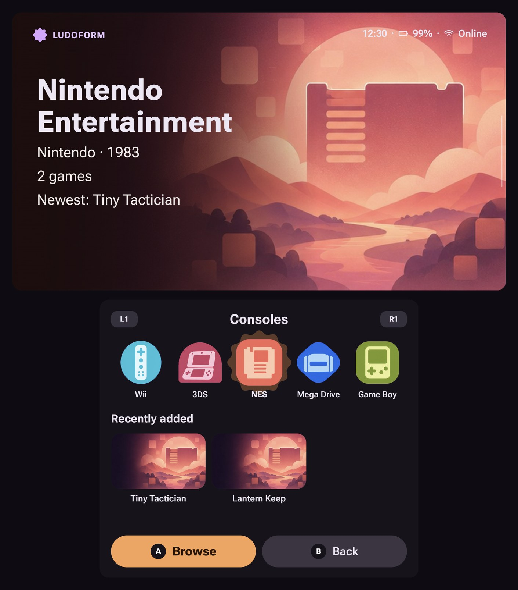
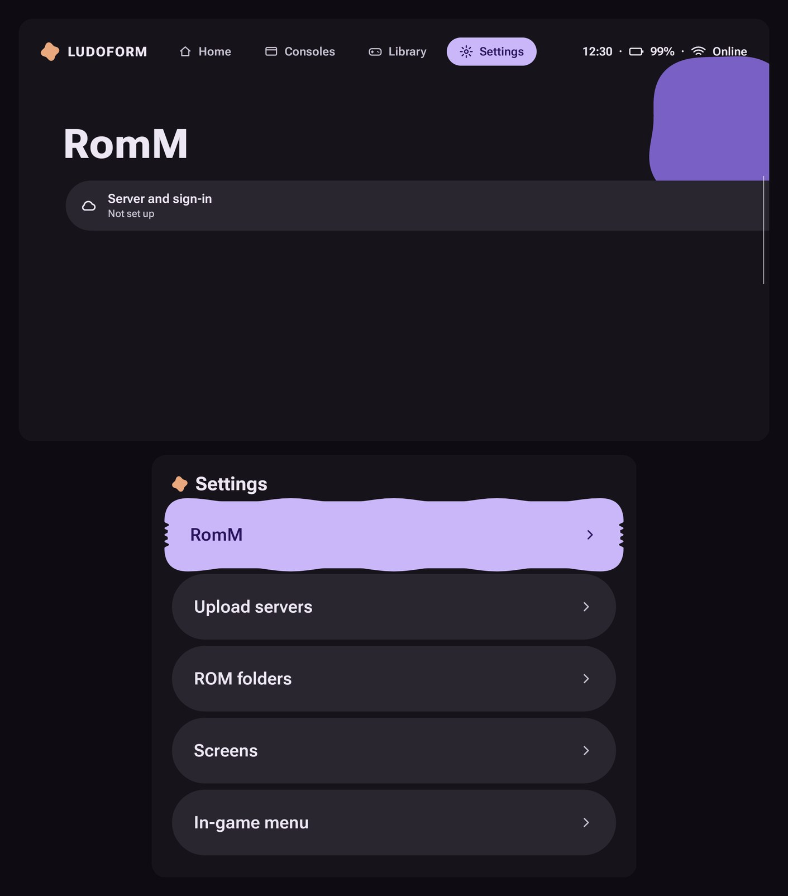

# Ludoform

**A dual-screen game launcher for the AYN Thor.**

Ludoform turns the Thor's two screens into one console front end. The top screen (the *Stage*) shows big, bold art for whatever you're looking at. The bottom screen (the *Deck*) is where you browse, choose and play, all with the controller. It finds the games on your device, works with a [RomM](https://github.com/rommapp/romm) server, and starts each game in the emulator you already use.



## Try it

**Download the showcase:** open the latest successful [Android CI run](https://github.com/lunikodevelopment/ludoformlauncher/actions/workflows/ci.yml?query=branch%3Amain+is%3Asuccess) and download the `ludoform-showcase` artifact (you need to be signed in to GitHub). Unzip it and install the APK on your Thor.

The showcase is Ludoform filled with a sample library of 39 games across 15 consoles, so you can try the whole interface without setting anything up. It installs next to Ludoform as **Ludoform Showcase** and leaves your own games alone. The sample games are made up. Their file names follow the No-Intro and Redump naming schemes, so titles, regions and disc sets look as they would with your own files. No ROMs are included, so starting a sample game just shows a note instead.

To use Ludoform with your own games, install `ludoform-debug` from the same run.

## Features

**Two screens, one console**
- Every screen is split across both displays: art and details on top, controls on the bottom.
- Designed for the controller first, with touch on both screens too.
- Couch mode: plug in a TV over USB-C and Ludoform moves to it, leaving the Thor's screens dark.

**Your library**
- Scans your ROM folders and groups multi-file games: `.cue`/`.bin`, `.gdi` tracks and `.m3u` disc sets.
- Cleans file names into proper titles and shows their regions: *Ember Vale (Europe) (En,Fr,De,Es,It).rvz* becomes **Ember Vale · Europe**.
- Cover art from an image next to the ROM, from RomM, or from the libretro thumbnail sets.
- Sort by name, date added, most played, recently played or unplayed. Mark favourites, and search your whole library.
- Tracks play time per game.

**Plays in your emulators**
- Opens each game directly in Dolphin, NetherSX2, DuckStation, PPSSPP, melonDS, Azahar, Citra or RetroArch.
- Remembers which emulator and which screen each game or console uses.
- Asks which disc to start for multi-disc games.

**RomM**
- Shows your RomM library next to your local games, and downloads games in the background. Downloads resume, and can wait for Wi-Fi or for charging.
- Syncs save files both ways. It backs up a save before replacing it, and lets you choose when both sides changed.
- Uploads games from the device to your RomM library over SFTP or SMB, with a review step that works out each game's console.

**In-game menu**
- Hold the two hinge buttons during any game to open a menu on the top screen: screenshot, screen recording, save sync, volume and brightness.
- Shows the game's RetroAchievements and its PDF manual when your RomM server has them.

**Make it yours**
- Dark, light and black themes. Accent colours can follow the focused game's cover, the console or your wallpaper.
- Haptics, interface sounds and your own background music.
- An app drawer for everything else on your Thor, with emulators, games and other apps in their own groups.

## Screenshots

Each picture shows the top screen above the bottom screen, as on the Thor.

| | |
|---|---|
|  |  |
| **Library**: every game, sorted your way | **Game details**: play, files and play time |
|  |  |
| **Consoles**: browse by system | **App drawer**: your other apps, grouped |
|  |  |
| **Quickstart**: a few steps to get going | **Settings** |

## How it was made

Ludoform was coded with heavy use of AI. The design concept is entirely mine, worked out as I went: what Ludoform is, how its two screens split the work, the look, the design boards and every feature all came from my own ideas and prompts. The code was written by AI from those prompts, mostly by Anthropic's Claude (in Claude Code), with OpenAI's ChatGPT (through Codex) for earlier parts of the work. I steered each step, tested the builds on my own Thor, and decided what stayed.

The decision log ([`docs/DECISIONS.md`](docs/DECISIONS.md)) marks which AI recorded each decision (Claude or Codex), and the handoff notes in `docs/` show how the work passed between them.

## Requirements

- An AYN Thor running Android 13 or later. Ludoform also runs on other Android 13+ devices, with both halves on one screen.
- The emulators you want to play with, installed from their usual sources.
- Optional: a [RomM](https://github.com/rommapp/romm) server, version 5.0 or newer.

Ludoform doesn't include or download any games. Use it with games you own.

## Building

```bash
./gradlew assembleDebug
```

```bash
./gradlew assembleShowcase
```

The first builds Ludoform, the second the showcase. You'll need JDK 17 and the Android SDK. The APKs are written to `app/build/outputs/apk/`.

## For contributors

- [`docs/BUILD-PROMPT.md`](docs/BUILD-PROMPT.md): the full specification
- [`docs/DECISIONS.md`](docs/DECISIONS.md): why things work the way they do
- [`docs/STATUS.md`](docs/STATUS.md) and [`docs/LOG.md`](docs/LOG.md): where the work stands
- [`docs/design/boards/`](docs/design/boards/): the design boards at the Thor's real proportions
- [`docs/HANDOFF-CLAUDE.md`](docs/HANDOFF-CLAUDE.md): the handoff for whoever continues the work
